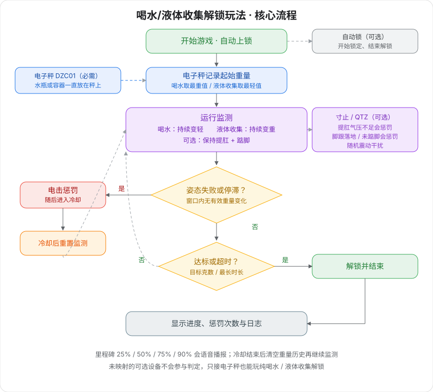

# 水飲み・液体回収アンロックプレイ

水筒や容器を電子はかりの上に置き、水を飲んで軽くするか、液体を回収して重くします。目標重量の変化に達するか、時間切れになると自動的にアンロックされます。肛門引き締めやつま先立ちの監視も追加でき、失敗すると電撃ペナルティが発動します。

## プレイ説明

- **水飲みモード（デフォルト）：** 水筒をずっとはかりの上に置き、ストローで継続的に水を飲んで重さを減らします。目標量軽くなればアンロックです。
- **液体回収モード：** 容器をずっとはかりの上に置き、その中に液体を回収して重くします。目標量重くなればアンロックです。
- **姿勢制約（オプション）：** 気圧 / つま先立ちデバイスをマッピングすると、肛門引き締めとつま先立ちを維持しなければ電撃されます。
- **オプションロック：** 自動ロックを接続すると、開始と同時にロックされ、目標達成またはタイムアウトでアンロックされます。

## デバイス要件

| デバイス | ロジック ID | 必須か | 役割 |
| --- | --- | --- | --- |
| [電子はかり](/docs/device/electronic-scale) | scale / DZC01 | はい | リアルタイム計量で、飲みによる軽量化または回収による重量化を判定 |
| [寸止め総合デバイス](/docs/device/cunzhi01) | sensor / cunzhi / punish / vibe | いいえ | 肛門引き締め気圧、つま先立ち圧力、電撃ペナルティ、ランダム振動 |
| [自動ロック](/docs/device/lock-controller) | lock / ZIDONGSUO | いいえ | 開始時にロック、終了時にアンロック |

マッピングされていないオプションデバイスは判定に参加しません。電子はかりのみ接続する場合は、純粋な水飲み / 液体回収アンロックになります。

寸止め総合デバイス1台で、肛門引き締め、つま先立ち、電撃、振動の4つの役割を同時に担えます。クライアントで対応するスロットにマッピングするだけです。

> 🛒 **プレイセット**：[公式サイトで購入](https://shop.undersilicon.cn/zh/products/force-drink)

## 装着と接続

まずクライアントをインストールしデバイスに接続してください。詳しくは [クライアントダウンロードとデバイス接続](/docs/player/new-phone-client)をご覧ください。

- **電子はかり**：平らな床に置きます。水筒（水飲み）または容器（液体回収）はゲーム中ずっとはかりの上に置いたままにしてください。持ち上げないでください。
- **骨盤底筋センサー（オプション）**：潤滑剤を併用し、横向きに寝てリラックスした状態でゆっくり挿入します。
- **電気パルスパッド（オプション）**：太ももの内側に貼り付け、左右に1枚ずつ。胴体、心臓、頭部への貼り付けは禁止です。
- **つま先立ちセンサー（オプション）**：靴下の中に入れてかかとに密着させるか、靴のかかとの位置に設置します。
- **ホスト固定（オプション）**：ストラップで寸止めホストを太ももに固定します。
- **自動ロック（オプション）**：独立したワイヤレスデバイス。ホストには接続しません。

配線接続は [寸止めプレイ第2世代使用チュートリアル](/docs/player/cunzhi01#operation-steps)をご覧ください。

## ソフトウェア設定

1. クライアントでプレイライブラリに入り、「水飲み・液体回収アンロックプレイ」を選択します。
2. 電子はかり（必須）をマッピングし、必要に応じて気圧、つま先立ち、電撃、振動、自動ロックもマッピングします。
3. 水飲みまたは液体回収を選択し、目標重量、最長時間、ペナルティパラメータを設定します。
4. 開始をクリックします。音声はデフォルトでオンで、パラメータでオフにできます。

## ゲームプレイ

### 基本ルール

+ **水飲みモード**：過程中の最重値を起点とし、起点から減少したグラム数で進捗を計算します。
+ **液体回収モード**：過程中の最軽値を起点とし、起点から増加したグラム数で進捗を計算します。
+ 履歴ウィンドウ（デフォルト 30 秒）内に「有効変化閾値」を超える変化が一度もない場合、停滞とみなしペナルティを発動します。
+ 気圧をマッピングしている場合、気圧は肛門引き締め閾値を超えている必要があります。
+ 寸止めつま先立ちをマッピングしている場合、かかとの圧力が閾値を超えてデバウンス時間も超えた場合、着地とみなしペナルティを発動します。

### 状態サイクル

+ **実行中**：毎秒、姿勢、停滞、ランダム振動をチェックし、重量進捗を累計します。
+ **ペナルティ**：電撃をトリガー（電撃未マッピングの場合は理由のみ記録）、対応する音声を再生します。
+ **クールダウン**：デフォルト10秒間検出を一時停止。終了後、重量履歴をクリアし、監視を再開します。
+ **アンロック済み**：進捗が目標に達するか最長時間に達した場合、ロックを解除して終了します。

### 音声と妨害

+ 開始、ペナルティ理由、クールダウン、達成 / タイムアウト / 手動終了はすべて読み上げられます。
+ 進捗が 25% / 50% / 75% / 90% に達するたびに1回ずつ読み上げます。
+ 実行中はランダムに励ましを放送し、接続済みの肛門引き締め / つま先立ちをリマインドします。
+ 毎秒、確率で振動妨害が1回トリガーされます（デフォルト約 5%）。

### ゲーム終了

+ 累計変化が目標重量に達した：アンロック成功。
+ 最長時間に達した：タイムアウトアンロック。
+ 手動終了でもロックが解除されます。
+ インターフェースには進捗、電撃回数、最後のペナルティ理由、ログが残ります。

## パラメータ説明

### 基本パラメータ

| パラメータ | デフォルト | 説明 |
| --- | --- | --- |
| プレイモード | 水飲み（軽量化） | 水飲み：はかりが軽くなれば達成。液体回収：はかりが重くなれば達成 |
| 最長時間 | 1800 秒 | タイムアウトで自動終了しアンロック。初心者はまず 900–1800 がおすすめ |
| 目標重量変化 | 500 g | 起点から変化させる必要のあるグラム数 |
| 音声プロンプト | オン | フェーズ、ペナルティ、マイルストーンの読み上げ |

### 判定と難易度

| パラメータ | デフォルト | 説明 |
| --- | --- | --- |
| 有効変化閾値 | 1 g | この変化未満はノイズとみなし、停滞カウントダウンを更新しません |
| 履歴ウィンドウ | 30 秒 | ウィンドウ内に有効な変化がなければペナルティ |
| 肛門引き締め気圧閾値 | 20 kPa | この値未満は肛門引き締めをしていないとみなす（気圧マッピング必須） |
| つま先立ち圧力閾値 | 100 | この値より高いとかかとが着地したとみなす |
| つま先立ちデバウンス | 300 ms | 寸止め圧力の揺れをフィルタリング。小さすぎると誤判定しやすい |

### ペナルティと妨害

| パラメータ | デフォルト | 説明 |
| --- | --- | --- |
| ペナルティクールダウン | 10 秒 | 電撃終了後の検出一時停止時間 |
| 電撃強度 | 24 V | 15–24 V を推奨。30 V を超えないこと |
| 電撃継続 | 2 秒 | 1回の電撃時間 |
| 振動起動確率 | 0.05 / 秒 | 約毎秒 5% |
| 振動強度 | 255 | 0–255 |
| 振動時間 | 3 秒 | 1回の振動時間 |

## インターフェース説明

+ **タスク進捗**：変化したグラム数 / 目標グラム数、および開始重量を表示。
+ **現在の重量 / 気圧 / つま先立ち状態**：リアルタイム読み取り値。
+ **ペナルティカウントダウン**：次の「停滞ペナルティ」までの残り秒数。
+ **電撃情報**：トリガー回数、マッピングされているか、現在電撃中か、クールダウン残り、前回理由。
+ **システム指標**：モード、ウィンドウ内の最小/最大重量、サンプル数など。
+ **システムログ**：開始、進捗、ペナルティ、クールダウン、終了記録。

## 使用上のヒント

+ 水筒や容器はずっとはかりの上に置いてください。水を飲むときはストローを使い、ボトルごと持ち上げないでください。重量が急降下し、達成と直接判定される可能性があります。
+ 体重による判定への影響を避けるため、はかりの上に人が乗らないでください。
+ 最初は電子はかりのみ接続し、まず水飲みフローを通してから、肛門引き締め、つま先立ち、電撃を追加してください。
+ 目標はまず 200–300 g、ウィンドウはまず 45–60 秒に設定し、慣れてから厳しくしてください。
+ 電撃を接続する場合は、低電圧・短時間から始めてください。

## 安全上の注意

+ 健康状態に問題がなく、心臓病、てんかんなどの疾患がないことを確認してください。18歳以上の成人のみ使用可能です。
+ 低強度・短時間から始めることを推奨します。不快感がある場合は直ちに中止してください。
+ 電気パルスの安全性と電圧制限については [ソロプレイ必読](/docs/player/solo-safety)をご覧ください。
+ 水を過剰に飲まないで、速く飲みすぎないでください。胃腸や泌尿器系に不快感がある場合は、液体回収モードを使用しないでください。
+ 自動ロックを接続する場合は、周囲に助けを求められる人がいることを確認してください。自動ロックの挙動は [ソロプレイ必読](/docs/player/solo-safety)をご覧ください。
