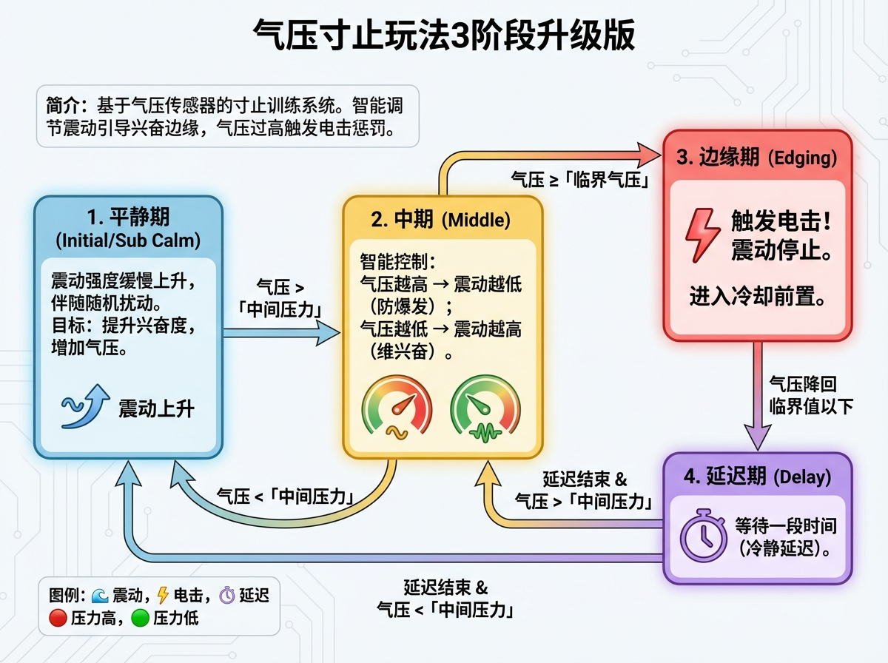
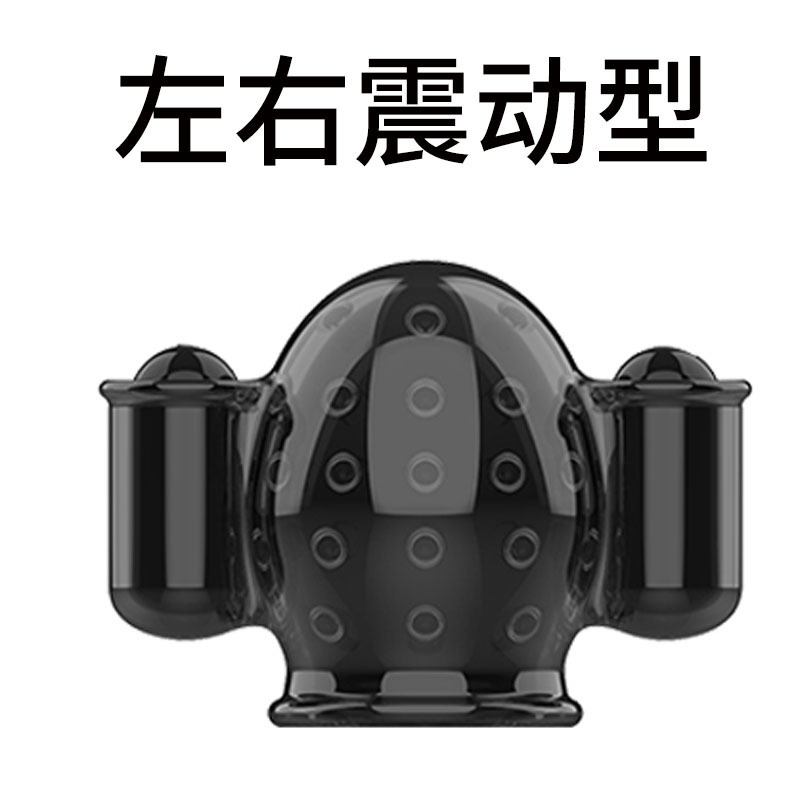

# 寸止めプレイアップグレード版（3フェーズ版）第2世代

## はじめに
これは気圧センサーに基づいた寸止めトレーニングプレイです。システムは気圧値に基づき振動強度を知的に調整し、ユーザーが興奮のエッジに留まるよう誘導します。気圧が臨界値を超えると、電撃によるペナルティが発生します。

短時間の気圧上昇でトリガーし、毎ラウンド自動的に中間圧力を補正する別のプレイもあります：

[気圧急変寸止めプレイ説明](/docs/player/surge-edging)

## プレイ紹介

Bilibili: https://www.bilibili.com/video/BV1ZicuzkESJ/
YouTube: https://youtu.be/HvIN5CQ44dI

[使用前の説明はこちら（必ずお読みください）](#use_instruction)

## ゲームの流れ
ゲームは以下の状態が循環します：

1.  **平穏期 (Initial/Sub Calm)**
    - 振動強度がゆるやかに上昇し、ランダムな揺らぎが伴います。
    - **目標**：興奮度を上げ、気圧を増加させます。
    - **遷移**：気圧が「中間圧力」を超えると中期に移行します。

2.  **中期 (Middle)**
    - 知的制御：気圧が高いほど振動強度は低く（早すぎる爆発を防ぐ）、気圧が低いほど振動強度は高くなります（興奮を維持）。
    - **遷移**：
        - 気圧 >= 「臨界気圧」：**電撃**が発生し、エッジ期に移行します。
        - 気圧 < 「中間圧力」：平穏期に戻ります。

3.  **エッジ期 (Edging)**
    - **電撃発生！** 振動は停止します。
    - **遷移**：気圧が臨界値を下回った後、遅延期に移行します。

4.  **遅延期 (Delay)**
    - 一定時間待機します（冷静遅延）。
    - **遷移**：遅延終了後、現在の気圧に応じて中期（中間圧力以上）または平穏期（中間圧力未満）に戻ります。

## 必要デバイス
1.  **寸止めセンサー (CUNZHI01)**：必須。興奮度を監視し、振動刺激を提供、およびエッジペナルティ（電撃）を行います。
    - 購入アドレス：https://item.taobao.com/item.htm?ft=t&id=1028272889035

2.  **自動ロック (ZIDONGSUO)**：任意。ゲーム開始時に自動でロックされ、終了時に解除されます。
    - 購入アドレス：https://item.taobao.com/item.htm?ft=t&id=925058360048

## 購入リンクおよび関連バージョン説明 {#buy-link-info}

淘宝: https://item.taobao.com/item.htm?id=1028272889035

### 購入ガイド

寸止め版かフルセットか、自動ロックやバイブレーターマシンコントローラーを追加するかどうかは [寸止め総合デバイス購入ガイド](/docs/device/cunzhi01#导购) をご覧ください。

### バージョン紹介

#### 男性用

【フルセット】寸止めデバイス（気圧+振動+電撃）+男性用シングルアイテム+つま先センサー

【寸止めセット】寸止めデバイス（気圧+振動+電撃）+男性用シングルアイテム

【OSR6セット】寸止めデバイス（気圧+振動+電撃）

付属品リストと女性用バージョンは [寸止め総合デバイス](/docs/device/cunzhi01#版本介绍) をご覧ください。

### 用語解説

寸止めデバイス、ロック、男性用/女性用シングルアイテムなどの用語説明は [寸止め総合デバイス用語解説](/docs/device/cunzhi01#名词解释) をご覧ください。

## 使用説明 {#use_instruction}

1. デバイスの組み立てを完了し、装着します。（詳しくは [組み立てと装着](/docs/device/cunzhi01/assembly) をご参照ください）
   - OSR6版の方は [OSR6プレイ説明](/docs/device/osr6-control-plugin) をご参照ください。
2. すべてのデバイスをネットワークに接続します。
   - スマートフォン：[スマートフォンクライアント](/docs/player/new-phone-client) をご参照ください。
   - パソコン：[PC版コントロールクライアント](/docs/player/new-phone-client#pc) をご参照ください。

3. 中間圧力と臨界気圧を設定します。**この二つの値は固定値ではありません。起動後、未装着時の「平穏状態読数」を基準に調整してください**：
   - 未装着時の読数は通常 0 ではありません（シリコン外皮自体に圧力があるため、50~60 前後が一般的で、正常です）。
   - 参考起点：**中間圧力 ≈ 平穏値 + 2、臨界圧力 ≈ 平穏値 + 5**。例えば平穏時の読数が 60 なら、中間を 62、臨界を 65 に設定します。
   - 上記はあくまで起点です。実際はプレイ感覚に応じて再調整してください：我慢できなければ下げ、感じにくければ上げ、プレイしながら調整するのが最適です。

## 刺激デバイス紹介

> 注：セットには振動ミニバイブレーターが2個含まれています。1個は先端、1個は上部側面に配置することをお勧めします。

## 設定説明

| パラメータ名 | 説明 | 推奨値 |
| :--- | :--- | :--- |
| **ゲーム時間** | ゲームの総実行時間（分）。 | 20 |
| **臨界気圧** | 電撃と寸止めが発生する最高気圧しきい値 (kPa)。 | 平穏値 + 5（参考、実際は微調整必要） |
| **TD01最大強度** | 振動の最大強度 (1-255)。 | 255 |
| **中間(興奮)圧力** | 知的制御段階に入るための圧力しきい値 (kPa)。 | 平穏値 + 2（参考、実際は微調整必要） |
| **電撃強度** | ペナルティ時の電圧強度 (V)。 | 20 |
| **電撃持続時間** | ペナルティの持続時間（秒）。 | 3 |
| **低圧遅延** | 寸止め発生後のクールダウン休憩時間（秒）。 | 5 |
| **強度増加率上限** | 振動強度が増加する最大速度。急激な変化を防ぎます。 | 10 |
| **強度ランダム揺らぎ** | 振動強度のランダムな変動幅 (%)。 | 0 |
| **遅延後徐々に上昇** | 平穏期に振動強度が毎秒自動的に増加する値。 | 10 |

## 安全使用説明

電気パルスデバイスの電圧は高く設定しすぎず、電流が胴体を通らないようにしてください。その他の安全事項は [ソロプレイ必読](/docs/player/solo-safety) をご覧ください。

## バージョンアップグレード説明

第2世代バージョンでは、電撃、気圧、振動の3つのデバイスがアップグレードされ、1台のデバイスに統合されました。設定方法に変化はありません。

旧世代デバイスをご利用の場合はチュートリアル [気圧寸止めプレイ3フェーズアップグレード版説明](/docs/player/old/cunzhi3step) をご参照ください。
