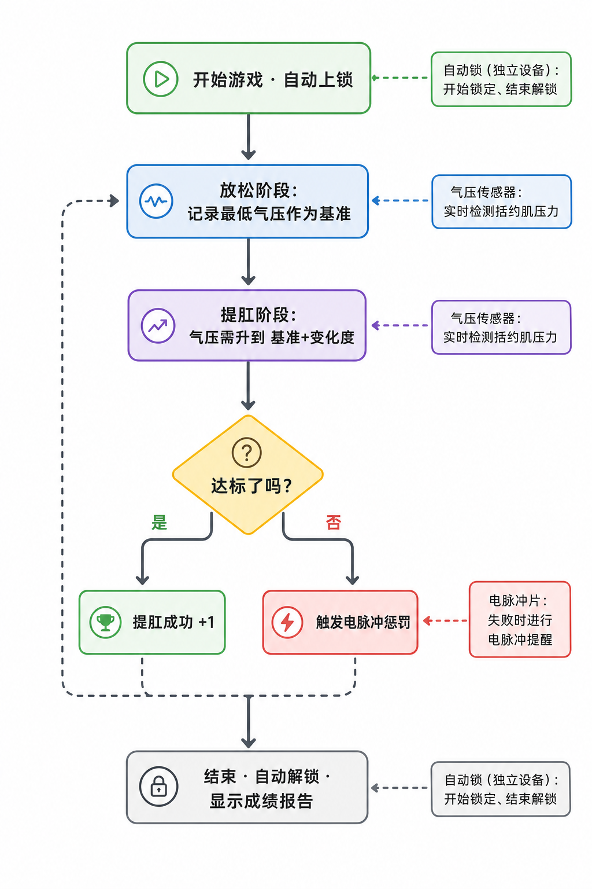

# 肛門引き締めトレーニングプレイ（第2世代）

「リラックスフェーズ」と「肛門引き締めフェーズ」を交互に行い、骨盤底筋をトレーニングします。規定時間内にできるだけ多くの「肛門引き締め成功」を達成してください。失敗すると電気パルスによる注意喚起が発生します。

> 🛒 **デバイス入手**：[淘宝で購入](https://item.taobao.com/item.htm?id=1028272889035)

## プレイ説明

- **肛門引き締めトレーニングプレイ：** デバイスは気圧センサーで括約筋の圧力変化をリアルタイム検出し、「リラックス」と「肛門引き締め」の2フェーズで交互にトレーニングします。
- **目標：** 規定時間内にできるだけ多くの「肛門引き締め成功」を達成。成功・失敗はインターフェースで直感的に表示されます。
- **オプションロック：** 自動ロックを接続すると、ゲーム開始と同時にロックされ、終わるまで出られません。

## 装着と接続

まずはクライアントをインストールし、デバイスを接続してください。詳細は[クライアントダウンロードとデバイス接続](/docs/player/new-phone-client)をご参照ください。

- **骨盤底筋センサー（アナルプラグ）**：潤滑剤とともに使用し、横向きに寝てリラックスした状態でゆっくり挿入してください。括約筋の圧力変化を検出します。
- **電気パルスパッド**：太ももの内側に左右各1枚ずつ貼り付け、失敗時の注意喚起フィードバックに使用します。
- **ホスト固定**：ストラップで寸止め総合デバイスのホストを太ももに固定します。
- **自動ロック（任意）**：独立したワイヤレスデバイスで、ホストには接続しません。接続するとゲーム開始と同時にロックされ、終わるまで出られません。終了時に自動アンロックします。購入リンク：[シンプルスマートロック端末](https://item.taobao.com/item.htm?ft=t&id=925058360048)
- **配線接続**：各コンポーネントのもう一端をホストに接続します。接続方法は以下の通りです：

## ソフトウェア設定

1. **ゲーム選択画面に入る**：クライアントでゲーム選択画面に進みます。
2. **プレイ選択**：「肛門引き締めトレーニング」プレイを選択します。
3. **パラメータ設定**：持続時間、肛門引き締め回数目標、気圧変化度、電撃強度などのパラメータを設定します（プレイ中でもいつでも変更可）。
4. **体験開始**：「開始」をクリックしてゲームに入ります。

## ゲームプレイ

### コアルール
「リラックス → 肛門引き締め → リラックス → …」のサイクルで交互に行い、肛門引き締めフェーズで気圧を目標値まで上げれば「肛門引き締め成功」と判定されます。

### プレイフロー
+ **リラックスフェーズ**
    - 力を抜き自然に呼吸します。システムはこのフェーズの「最低気圧」を参考値として記録します。
    - カウントダウン終了後、肛門引き締めフェーズに移行します。
+ **肛門引き締めフェーズ**
    - このフェーズの時間内に、気圧を「最低気圧 + 気圧変化度」まで上げる必要があります。
    - 目標に到達すると「達成済み」と判定されますが、このフェーズのカウントダウンが終了するまで次のラウンドには進みません。
    - フェーズ終了までに未達の場合、「挑戦失敗 · 電撃開始」と判定されます。
+ **フェーズ交代**
    - 各ラウンドは「リラックス → 肛門引き締め → リラックス → …」のサイクルで、時間終了または目標回数達成まで繰り返されます。

### ゲーム終了
+ 設定した持続時間に到達、または成功回数が目標に達すると終了します。
+ 終了後は自動アンロックされます（自動ロックを接続している場合）。
+ インターフェースに累計成功回数や電撃回数などが表示されます。

## パラメータ説明
+ `持続時間(分)`：ゲーム全体の時間
+ `肛門引き締め回数目標`：達成を目指す成功回数。総進捗の表示に使用
+ `気圧変化度(kPa)`：肛門引き締めフェーズで達成が必要な気圧増加閾値（リラックスフェーズの最低気圧からの相対値）
+ `電撃強度(V)`：失敗時の電撃強度
+ `電撃継続時間(秒)`：失敗時の電撃継続時間
+ `1サイクル時間(秒)`：各フェーズの時間。デフォルト10秒（リラックス10秒 → 肛門引き締め10秒 → サイクル）

## 使用上のヒント
+ 初めての使用では「気圧変化度」を低めに設定し、リズムに慣れることをお勧めします
+ 電撃デバイスを接続する場合は、低強度から始めて徐々に調整してください
+ 呼吸を安定させ、肛門引き締めフェーズでは目標圧力到達に集中してください

## 安全注意
+ 体調が健康であることを確認し、心臓病、てんかんなどの疾患がない方のみご使用ください。18歳以上の成人のみ使用可能です
+ 低強度・短時間から始めることをお勧めします。プレイ中に体調不良を感じた場合は直ちに中止してください
+ 電気パルスの強度は慎重に設定してください。高すぎるとけがの原因になります。リスクは自己責任でご負担ください
+ デバイスの安全と電気パルス使用上の注意は [ソロプレイ必読](/docs/player/solo-safety) をご覧ください

## バージョンアップグレード説明

第2世代バージョンでは、気圧センサー（QIYA）、電撃（DIANJI）などの独立デバイスがアップグレードされ、1台の寸止め総合デバイス（気圧センシング + 振動 + 電気パルス三合一）に統合されました。設定方法に変化はありません。

旧世代デバイスをご利用の場合はチュートリアル：[肛門引き締めトレーニングプレイ（旧バージョン）](/docs/player/old/kegel-training) をご参照ください。
