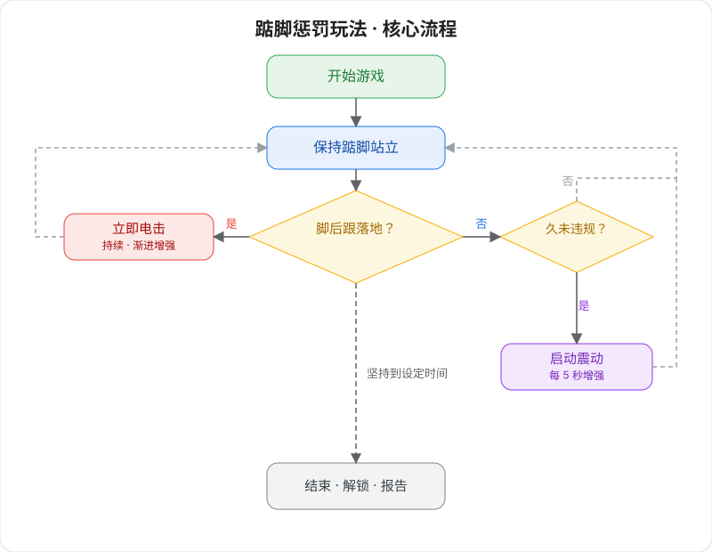

# つま先立ちペナルティプレイ v2（第2世代）

ハイテク体感自律トレーニングゲーム —— つま先立ちを維持し、かかとが着地したらペナルティ。

> 🛒 **デバイス入手**：[淘宝で購入](https://item.taobao.com/item.htm?id=1028272889035)

## プレイ説明

- **つま先立ちペナルティプレイ：** デバイスはあなたのかかとの位置をリアルタイムで検出します。かかとが着地すると電気パルスによるペナルティが発生し、常につま先立ちの姿勢を維持する必要があります。
- **オプションロック：** 自動ロックを接続すると、ゲーム開始と同時にロックされ、終わるまで出られません。

## 装着と接続

まずはクライアントをインストールし、デバイスを接続してください。詳細は[クライアントダウンロードとデバイス接続](/docs/player/new-phone-client)をご参照ください。

- **電気パルスパッド**：太ももの内側に左右各1枚ずつ貼り付け、ペナルティフィードバックに使用します。
- **つま先立ちセンサー**：靴下の中にかかとに密着させて入れるか、靴のかかとの位置に設置してください。
- **ホスト固定**：ストラップで寸止め総合デバイスのホストを太ももに固定します。
- **配線接続**：各コンポーネントのもう一端をホストに接続します。

## ソフトウェア設定

1. **ゲーム選択画面に入る**：クライアントでゲーム選択画面に進みます。
2. **プレイ選択**：「つま先立ちペナルティプレイ」を選択します。
3. **パラメータ設定**：ゲーム時間、電気パルス強度、プログレッシブモードなどのパラメータを設定します（プレイ中でもいつでも変更可）。
4. **体験開始**：「開始」をクリックしてゲームに入ります。

## ゲームプレイ

### コアルール
つま先立ちの姿勢を維持し、かかとは絶対に地面に接触させないこと！

### 監視メカニズム
+ つま先立ちセンサーがかかとの位置をリアルタイム監視
+ かかとが着地した = 違反。直ちに電気パルスペナルティが発生
+ かかとを上げるまでペナルティは停止しません

### ペナルティシステム
+ 🔴 **即時ペナルティ**：かかとが着地した瞬間に電気パルス開始
+ 📈 **プログレッシブ強度**：違反回数が増えるほど電気パルス強度が自動的に増加
+ ⏱️ **継続ペナルティ**：かかとが地面に触れている間は電気パルスが継続し、完全に上げるまで止まりません
+ 🎮 **振動増強**：良好な状態（違反なし）が一定時間続くと、ホストの振動妨害が起動し、強度は徐々に増加します

### 振動増強メカニズム
+ **遅延起動**：電気パルス未発生の指定時間後に自動起動
+ **強度増加**：強度は時間とともに徐々に増加
+ **自動停止**：電気パルスが発生すると自動的に停止・リセットされます

### ゲーム終了
+ 設定時間を耐え抜くと自動アンロック
+ システムが完全なパフォーマンスレポートを表示し、違反回数やペナルティ回数などのデータを統計します

## チャレンジポイント
+ **体力チャレンジ**：長時間のつま先立ちは脚部筋肉の持久力を試します
+ **意志力の試練**：疲労時でも標準姿勢を維持する必要があります
+ **精密コントロール**：わずかなかかとの沈み込みも検出されます
+ **心理戦**：電気パルスの脅威下で冷静と集中を保つ必要があります
+ **二重のプレッシャー**：ペナルティを避けると同時に振動妨害にも対処する必要があります

## 勝利条件
設定時間の終了まで耐え抜くこと。違反回数が少ないほど成績が優れます：

+ 🌟 **パーフェクト**：違反0回
+ ⭐ **優秀**：違反1〜2回
+ 👍 **良好**：違反3〜5回
+ 😅 **要改善**：違反5回以上

## 安全注意
+ 体調が健康であることを確認し、心臓病、てんかんなどの疾患がない方のみご使用ください。18歳以上の成人のみ使用可能です
+ 低強度・短時間から始めることをお勧めします。プレイ中に体調不良を感じた場合は直ちに中止してください
+ 電気パルスの強度は慎重に設定してください。高すぎるとけがの原因になります。リスクは自己責任でご負担ください
+ デバイスの安全と電気パルス使用上の注意は [ソロプレイ必読](/docs/player/solo-safety) をご覧ください

## バージョンアップグレード説明

第2世代バージョンでは、TD01（振動）、電撃、つま先立ちセンサーの3つのデバイスがアップグレードされ、1台の寸止め総合デバイスに統合されました。設定方法に変化はありません。

旧世代デバイスをご利用の場合はチュートリアル：[つま先立ちペナルティプレイ v2（旧バージョン）](/docs/player/old/tiptoe-v2) をご参照ください。
