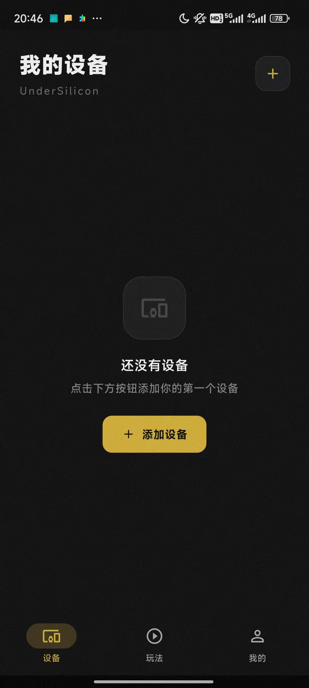
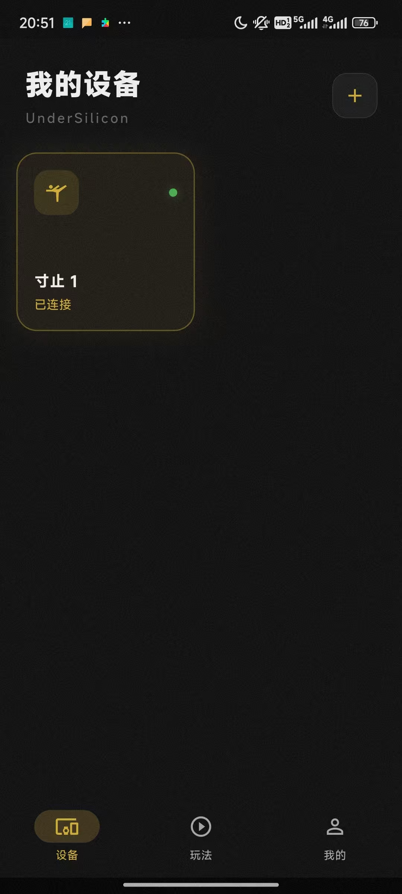

# クライアントダウンロード

# その他のクライアント

[iOS](./iOS客户端.md) | [HarmonyOS](./鸿蒙客户端.md) | [PC](./PC版控制客户端.md)

Androidダウンロードリンク：https://dl.undersilicon.cn/apk/latest/app-release.apk

# デバイス接続（例：cunzhi01）

1. デバイスを起動します。この時点でデバイスの青いランプは点滅状態であるはずです（点滅しない場合はまず充電してください）。
2. クライアントを開き、「デバイスを追加」または右上のプラスアイコンをタップします。
   
3. 「デバイスを追加」をタップします。
   
4. 「完了」をタップします。
   
5. これで追加が成功し、正しく接続されました。接続成功後、青いランプは数秒間点灯した後に消灯します。
   