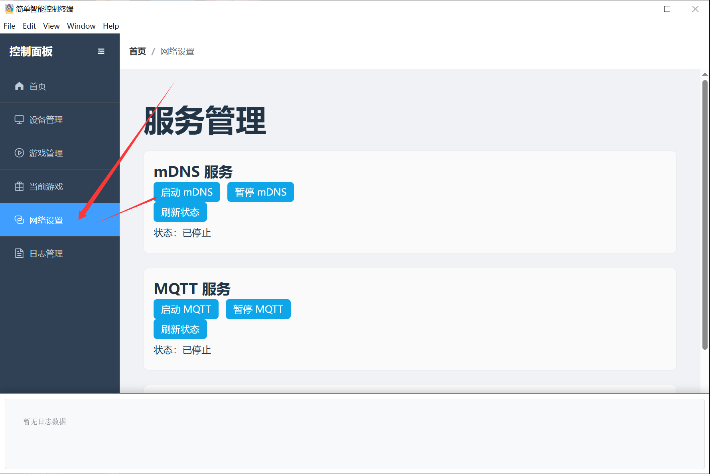

# クライアントダウンロード

## Androidクライアント {#安卓客户端}

Androidダウンロードリンク：https://dl.undersilicon.cn/apk/latest/app-release.apk

### デバイス接続（例：cunzhi01）

1. デバイスを起動します。この時点でデバイスの青いランプは点滅状態であるはずです（点滅しない場合はまず充電してください）。
2. クライアントを開き、「デバイスを追加」または右上のプラスアイコンをタップします。
   
3. 「デバイスを追加」をタップします。
   
4. 「完了」をタップします。
   
5. これで追加が成功し、正しく接続されました。接続成功後、青いランプは数秒間点灯した後に消灯します。
   

## iOS クライアント {#ios}

App Store で「硅基之下」を検索するか、以下のリンクをクリックしてダウンロード：

- App Store リンク：[https://apps.apple.com/app/硅基之下/id6777638368](https://apps.apple.com/app/%E7%A1%85%E5%9F%BA%E4%B9%8B%E4%B8%8B/id6777638368)
- 現在のバージョン：1.0

## HarmonyOSクライアント {#鸿蒙客户端}

「Undersilicon」を検索し、AppGalleryでダウンロード・インストールできます。

## PCクライアント {#pc}

Bilibili: https://www.bilibili.com/video/BV1jBcuzGEyC/
YouTube: https://youtu.be/1m-OEwx_Gjg

### 使用ガイド
1. ダウンロードリンク：[https://firmware.undersilicon.cn/control-panel/stable/UnderSilicon.zip](https://firmware.undersilicon.cn/control-panel/stable/UnderSilicon.zip)
2. **解凍してからインストールしてください （解凍に失敗した場合は [7zip](https://www.7-zip.org/download.html) をインストール後、そのソフトで解凍してください）**
3. **クライアントを起動する**
4. **PCのWiFiホットスポットを有効にし、WiFi名を `easysmart`、パスワードを `11111111`（8つの1）、バンドを**2.4G**に設定する（[PCホットスポットなしの設定方法](#无电脑热点情况使用方式)）**
注意：デバイスが既に5Gの他のWiFiに接続している場合、デバイスが2.4Gで設定されていても5Gバンドのままになる可能性があります。その場合は、デバイスを2.4G WiFi（または有線LAN）に接続する必要があります。
5. **デバイスがWiFiに接続しているのにクライアントに表示されない場合は、ファイアウォールにブロックされている可能性があります。PCのファイアウォールを無効にしてください。**
6. **デバイスを起動し、起動後約15〜30秒で自動的にPCに接続されます**
7. **これで楽しく操作できます**

### PCホットスポットがない場合の使用方法 {#无电脑热点情况使用方式}
1. デバイスをWiFiに接続する：[APPでデバイスをWiFiに接続する](/docs/other/wifi-config/app)を参考に、デバイスを自宅のWiFiに接続します（必ず2.4G WiFiを選択してください）
2. クライアントでmDNSを有効にする

### その他のダウンロードリンク

安定版: https://firmware.undersilicon.cn/control-panel/stable/UnderSilicon.zip

テスト版: https://firmware.undersilicon.cn/control-panel/test/UnderSilicon.zip

過去バージョン: https://github.com/jiandanzhineng/control-panel/releases
