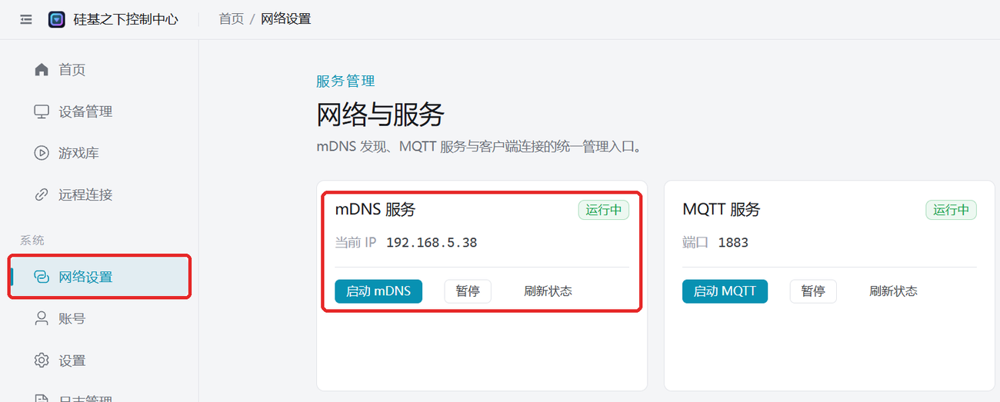

# 自宅WiFiへのネットワーク設定

デバイスを自宅のルーターに接続します。適した場面：PCでホットスポットが起動できない（デスクトップPCにワイヤレスカードがない、会社のPCでホットスポットが禁止されているなど）、スマートフォンからの遠隔操作が必要、ファームウェアアップグレード、複数デバイスの同時オンライン。

:::note
デバイスの Bluetooth と WiFi はどちらか一方のみです。ネットワーク設定に成功すると、デバイスの Bluetooth は自動的にオフになります。スマートフォンの Bluetooth ダイレクト接続に戻るには、デバイスを BLE モードに切り替える必要があります。
デフォルトWiFi（名前 `easysmart`、パスワード `11111111`）を使うだけならネットワーク設定は不要です。デバイスが自動的に接続します。
:::

## 前提条件

- 自宅に **2.4G** WiFi があること（2.4G/5G 同名のデュアルバンドルーターでも可）。
- ルーターが mDNS に対応していること（ほとんど対応しています）。不明な場合は[ルーターが mDNS に対応しているか確認](/docs/other/check-mdns)をご覧ください。

## ステップ1：デバイスのネットワーク設定

いずれかの方法で、デバイスを自宅の 2.4G WiFi に接続します：

| 方法 | 必要なもの |
| --- | --- |
| [PCクライアントでネットワーク設定](/docs/other/wifi-config/pc-bluetooth) | PCに Bluetooth がある |
| [アプリでネットワーク設定](/docs/other/wifi-config/app) | スマートフォンに EspBlufi をインストール |
| [ミニアプリでネットワーク設定](/docs/other/wifi-config/miniprogram) | WeChat。スマートフォンがその WiFi に接続していること |

## ステップ2：PCクライアントでデバイスに接続

PCとデバイスが同じルーター下にあること（PCは有線LANでもWiFiでも可）。クライアントは mDNS を通じてLAN内でデバイスを見つけます。

1. クライアント起動時に自動的に mDNS がオンになります。左側の「ネットワーク設定」を開き、「mDNS サービス」が「実行中」と表示されればOKです。停止と表示されている場合は「mDNS を起動」をクリックします。
   
2. デバイスを再起動します。約15〜30秒後に「デバイス管理」に表示されます。

## デバイスが表示されない場合

- PCのファイアウォールを無効にしてから再試行してください。
- PCとデバイスが同じルーターに接続しているか確認してください。ゲストネットワークや AP アイソレーションが有効なネットワークでは互いに発見できません。
